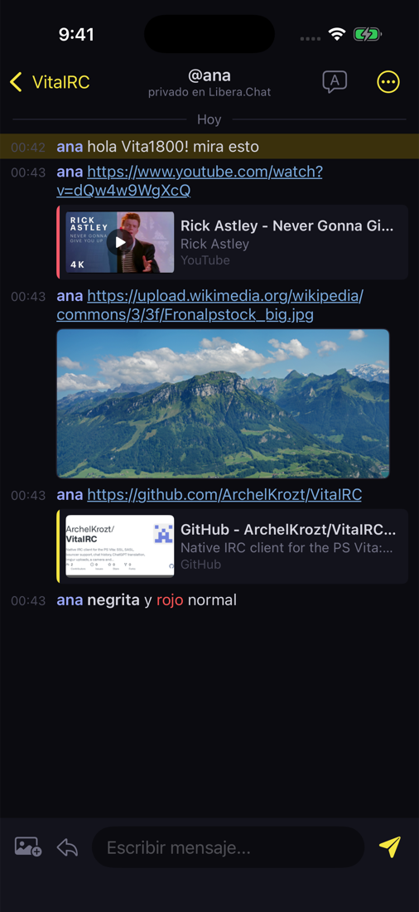
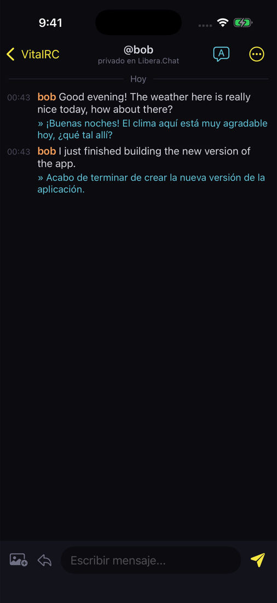
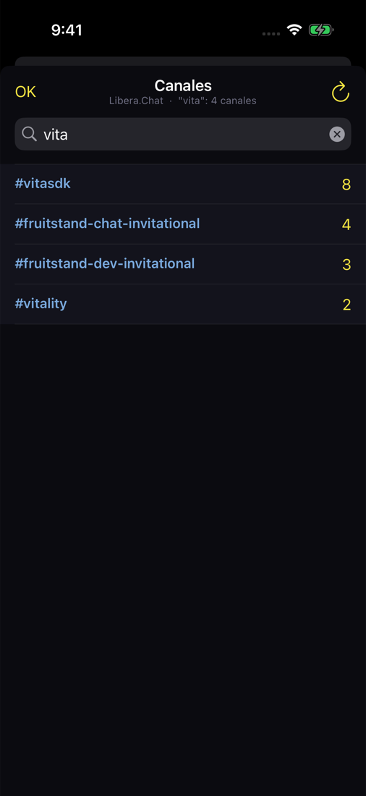

<h1 align="center">VitaIRC for iPhone</h1>

El cliente IRC de <a href="https://github.com/ArchelKrozt/VitaIRC">VitaIRC para PS Vita</a> y
<a href="https://github.com/ArchelKrozt/VitaIRC-Android">VitaIRC para Android</a>, para iPhone y iPad. 
Varios servidores, bouncers con historial, traducción, subida de imágenes, vista previa de enlaces y buscador de imágenes.

<a href="README.md">English</a> · <b>Español</b>

## Instalar

Las apps de fuera de la App Store deben firmarse con tu Apple ID, así que la primera vez toma unos
minutos: **[guía de instalación](INSTALL.es.md)** (AltStore, SideStore, Sideloadly o Xcode).
Baja `VitaIRC.ipa` de la [última versión](../../releases/latest). iOS 16 o superior.

## Funciones

**IRC**
- Varios servidores a la vez, SSL/TLS, SASL PLAIN, NickServ o contraseña del servidor, canales al
  conectar, recuperación del nick.
- Se reconecta solo y revisa la conexión al volver a la app; protección contra flood en privados.
- Lo que escribes sin conexión se ve atenuado y se envía al reconectar.

**Bouncers (soju, ZNC)**: IRCv3 `server-time`, `batch` y `chathistory` (lo que te perdiste llega con
su hora real, también los privados; los mensajes anteriores se cargan al subir), reacciones y subidas
con `FILEHOST` de soju.

**Traducción**: Google (gratis, sin cuenta) o ChatGPT con tu API key de OpenAI; mensajes recibidos,
los tuyos antes de enviarlos o uno solo; un idioma por canal.

**Imágenes y enlaces**: subida desde Fotos o la cámara (Litterbox sin cuenta, ImgBB, Imgur o soju),
vista previa de enlaces (miniaturas, GIF animados, tarjetas de páginas y YouTube, reproductor de
video), visor con zoom, guardar en Fotos, y buscador en Safebooru, Danbooru y Sankaku con favoritos.

**Pensado para iOS**: lista de ventanas y chat (lado a lado en iPad y en horizontal), menús nativos,
deslizar para cerrar una ventana, tocar un mensaje para responder, reaccionar o traducir, lista de
usuarios con acciones de operador, autocompletado de `@nick`, respuestas rápidas, explorador de
canales con búsqueda, notificaciones de privados y menciones.

### Segundo plano en iPhone

iOS corta las conexiones de una app poco después de salir de ella, así que VitaIRC no puede seguir
conectado en segundo plano como en Android. Se reconecta al abrirla; **con un bouncer (soju o ZNC) no
se pierde nada**: lo que se dijo mientras tanto llega con su hora real.

## Si vienes de la Vita o de Android

El archivo de ajustes es el mismo: copia `config.ini` a **Archivos → En mi iPhone → VitaIRC** y abre
la app. Los historiales usan el mismo formato.

## Compilar y licencia

La compilación está en el [README en inglés](README.md#building). Licencia [MIT](LICENSE).
