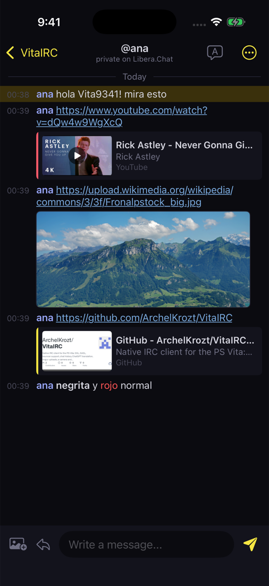
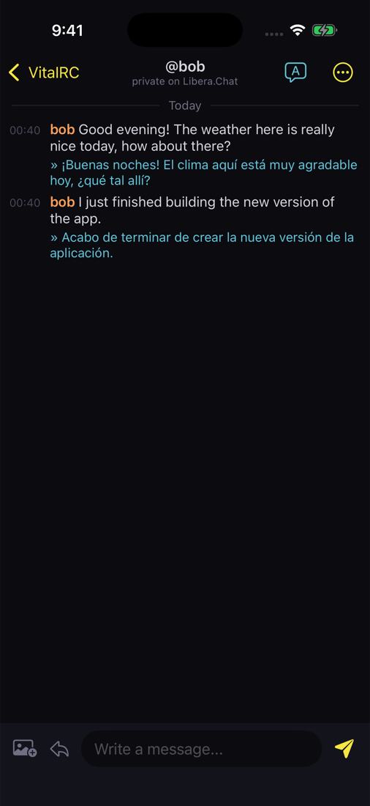
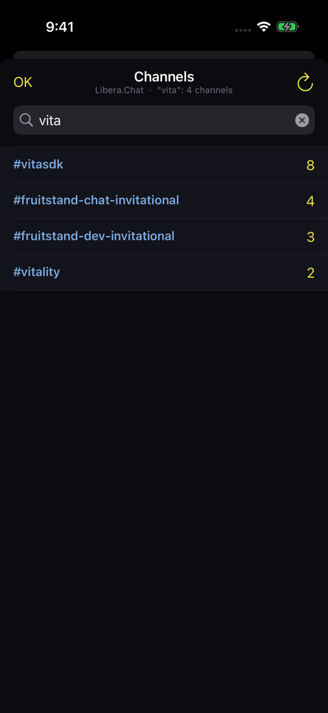
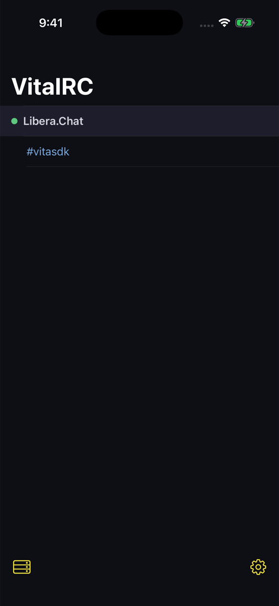
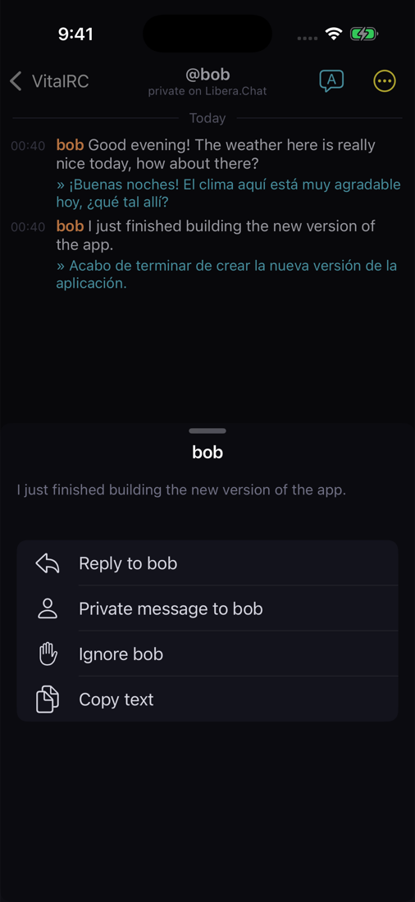
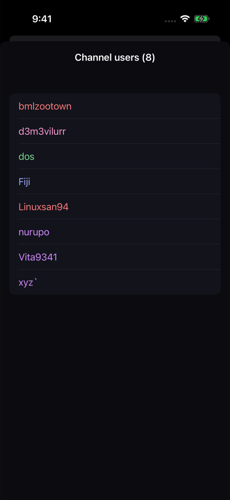
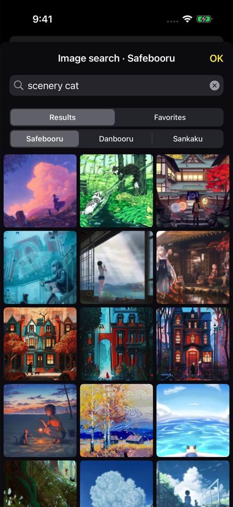
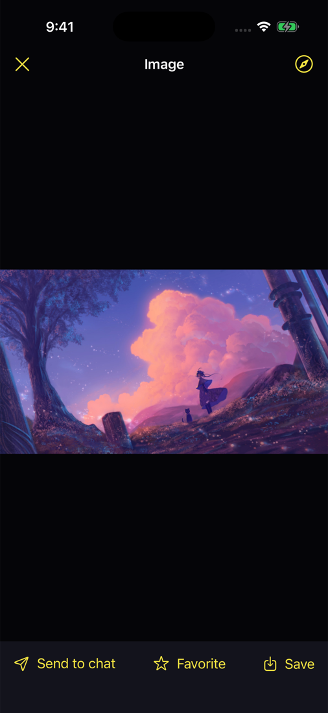
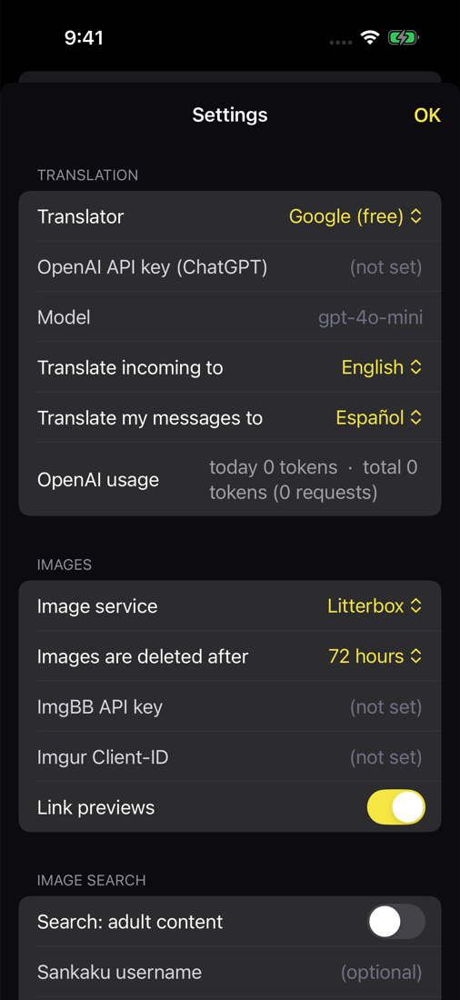

<p align="center"></p>

<h1 align="center">VitaIRC for iPhone</h1>

<p align="center">
The IRC client from <a href="https://github.com/ArchelKrozt/VitaIRC">VitaIRC for PS Vita</a> and
<a href="https://github.com/ArchelKrozt/VitaIRC-Android">VitaIRC for Android</a>, for iPhone and iPad.<br>
Several servers, bouncers with chat history, translation, image uploads, link previews and image search.
</p>

<p align="center"><b>English</b> · <a href="README.es.md">Español</a></p>

<p align="center">



</p>

## Install

Apps from outside the App Store must be signed with your Apple ID, so installing takes a few minutes
the first time: **[installation guide](INSTALL.md)** (AltStore, SideStore, Sideloadly or Xcode).
Get `VitaIRC.ipa` from the [latest release](../../releases/latest). iOS 16 or newer.

## Features

**IRC**
- Several servers at once, SSL/TLS, SASL PLAIN, NickServ or server password, auto-join, nick recovery.
- Reconnects by itself and checks the links when you come back to the app; flood protection for
  private messages.
- Messages typed without connection are shown dimmed and sent after reconnecting.
- Commands: `/join /part /msg /query /me /nick /topic /whois /list /notice /away /back /ignore
  /op /deop /voice /devoice /kick /ban /kickban /quote /connect /disconnect /clear /help`.

**Bouncers (soju, ZNC)**
- IRCv3 `server-time`, `batch` and `chathistory`: what you missed arrives with its real time, private
  conversations included; older messages load when you scroll to the top.
- Reactions (`+draft/react`) and soju's `FILEHOST` uploads.
- **Quoted replies** (`+draft/reply`): swipe a message to reply; the quote shows above the answer.
- **User cards**: tap a user for a floating card with their WHOIS and **VitaIRC profile** (name, bio,
  picture, public favorites). Your profile stays on your device and is sent over IRC to whoever asks,
  with no server in between ([protocol](docs/PROFILE-PROTOCOL.md)); works with the PS Vita and Android.
- Images sent from the image search carry the **artist's name**; videos play in a **floating window**.

**Translation**: Google (free, no account) or ChatGPT with your OpenAI API key; incoming messages,
your own before sending, or one message; a language per channel.

**Images and links**
- Upload from Photos or the camera to Litterbox (no account), ImgBB, Imgur or your soju server.
  Recent uploads keep their delete links.
- Link previews: image thumbnails (animated GIFs too), cards for pages and YouTube, video player.
- Image viewer with pinch zoom and double tap; save to Photos.
- Image search on Safebooru, Danbooru and Sankaku, with favorites and *send to chat*. General
  content only unless adult content is enabled in Settings (18+).

**Made for iOS**
- The window list and the chat (side by side on iPad and in landscape), native menus, swipe to close
  a window, long-press to mute it.
- Tap a message to reply, react, translate it, open a private chat, ignore or copy.
- User list with operator actions, `@nick` completion, quick replies, channel browser with search on
  the whole server, search inside a channel, jump to the last mention, highlight words, mIRC colours,
  Spanish and English.
- Notifications for private messages and mentions.

### Background on iPhone

iOS stops an app's network connections shortly after you leave it, so VitaIRC can't stay connected
in the background like the Android version. It reconnects when you open it; **with a bouncer (soju or
ZNC) nothing is lost**: what was said meanwhile arrives with its real time.

## Screenshots

| | | |
|---|---|---|
|  |  |  |
|  |  |  |

## Coming from the Vita or Android

The settings file is the same: copy `config.ini` into **Files → On My iPhone → VitaIRC** and open the
app. Chat logs use the same format.

## Building

The IRC core is a Swift package (`Sources/VitaIRCCore`) that also builds on macOS:

```sh
swift run CoreChecks                    # checks of the core
VITAIRC_LIVE=1 swift run CoreChecks     # plus a real connection to Libera.Chat and the web services
python3 tools/gen_strings.py            # after adding texts: English table -> L.swift
```

The app (`App/`, SwiftUI) needs Xcode and [XcodeGen](https://github.com/yonaskolb/XcodeGen):
`xcodegen generate && open VitaIRC.xcodeproj`. GitHub Actions builds every push, runs the app's demo
mode in the simulator to take the screenshots (`tools/screenshots.sh`) and packages the unsigned IPA;
tags (`v1.1`...) publish a release.

## License

[MIT](LICENSE).
